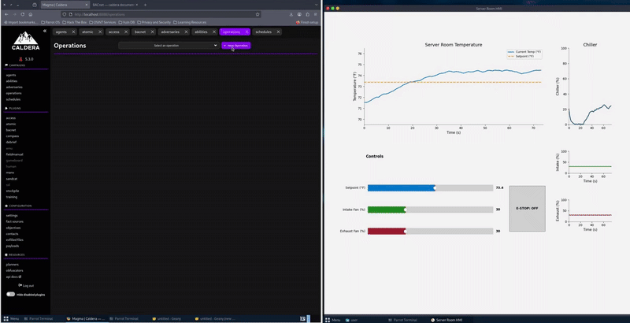

# HVACSim

A simulated server-room HVAC controller with BACnet process control, built as a target for [MITRE Caldera™ for OT](https://github.com/mitre/caldera-ot). For a walkthrough, read [Caldera for OT HVACSim: Expanding Access to OT Security Education](https://medium.com/@mitrecaldera/caldera-for-ot-hvacsim-expanding-access-to-ot-security-education-c4fcc47396ab).



## Authors

Created by University of Hawaii at Manoa students: Elijah Saloma and Jake Dickinson, advised by Samir Boussarhane.

In collaboration with MITRE Caldera™ for OT ([ot@mitre.org](mailto:ot@mitre.org)).

HVACSim is intended to grow open source collaboration in OT. We encourage forks and pull requests with improvements, new features, deployment notes, documentation, and tests.

The students' original version is preserved in the [v1.0.0 release](https://github.com/mitre/hvac-sim/releases/tag/v1.0.0).

## Description

HVACSim models a server room cooled by an intake fan, an exhaust fan and a chiller. The PLC is a BACnet/IP device that runs the thermal model and exposes the setpoint, the fan speeds and the emergency stop as writable objects, and the room temperature and chiller load as read-only inputs. The HMI is a separate BACnet client that polls the PLC and shows the process, so writes from Caldera show up on screen.

* Room temperature driven by ambient heat, server load, airflow cooling and chiller cooling
* A PI-controlled chiller with actuator lag
* Sensor and actuator noise
* An emergency stop that turns off the fans and the chiller
* An HMI with a temperature trend, chiller and fan charts, setpoint and fan sliders, and an emergency-stop button

## Getting Started

### Dependencies

* Python 3.12+
* BAC0, bacpypes3, matplotlib, tornado (see `requirements.txt`)
* Tkinter for the desktop HMI window ([Installation - TkDocs](https://tkdocs.com/tutorial/install.html))

### Installation

```bash
git clone https://github.com/mitre/hvac-sim.git
cd hvac-sim
pip install -r requirements.txt
```

## Usage

### Run Script

```bash
python run.py
```

The script asks how to run the simulator:

```
HVACSim Simulator

Deployment:
1. PLC only
2. HMI only
```

* **PLC only** runs the PLC. The host is the address it binds to (default `auto`).
* **HMI only** runs the HMI against a PLC elsewhere. The host is the PLC's address (default `127.0.0.1`).

It then asks for the PLC host and the PLC port (default `47808`) and, for HMI only, whether to serve the HMI as a web page (`Web HMI? [y/N]`). Local is not offered for BACnet, because the PLC and the HMI each need UDP 47808; run them on different hosts or containers.

### Modules

```bash
python -m simulator.plc
python -m simulator.hmi --host <PLC address> --web
```

PLC (`simulator.plc`):

| Flag | Default | Description |
|---|---|---|
| `--config PATH` | `config.ini` | Configuration file |
| `--host HOST` | `auto` | Address to bind: `auto` or `IP/prefix` |
| `--port PORT` | `47808` | BACnet/IP UDP port |
| `--debug` | off | Debug logging |

`config.ini` sets the device instance (`objectIdentifier`, default `101`) and the address to bind (`address`, default `auto`); `--host` overrides `address`. `auto` takes the IP address and subnet mask of the host's primary interface. The mask matters, because the PLC answers Who-Is broadcasts on that subnet.

HMI (`simulator.hmi`):

| Flag | Default | Description |
|---|---|---|
| `--host HOST` | `127.0.0.1` | PLC to poll; the PLC listens on its interface address, not `127.0.0.1`, so give that address |
| `--port PORT` | `47808` | PLC port |
| `--web` | off | Serve the HMI as a web page instead of a desktop window |
| `--web-port PORT` | `8090` | Web HMI port |
| `--device-id ID` | `101` | PLC device instance |
| `--fahrenheit` | off | Show temperatures in °F; the BACnet objects stay in °C |
| `--client-cidr PREFIX` | from the interface, else `24` | Prefix length of the HMI's own BACnet address; match the PLC's subnet |
| `--debug` | off | Debug logging |

The old flags `--ini`, `--address` and `--device-ip` still work, with a deprecation warning; use `--config` and `--host`.

### Docker

`docker/docker-compose.yml` runs the PLC, the web HMI, Caldera with the BACnet plugin, and a Sandcat agent on one network:

```bash
docker compose -f docker/docker-compose.yml up --build -d
```

| Service | Address |
|---|---|
| Caldera | http://localhost:8888 (login `admin` / `admin`) |
| Web HMI | http://localhost:8090 |

All ports are published on `127.0.0.1` only. Caldera starts with the HVACSim fact source and adversary profiles loaded.

BACnet/IP uses UDP 47808, and discovery uses broadcasts, which do not cross Docker's port publishing, so 47808 is not published to the host. Caldera's agent and the HMI reach the PLC on the Docker network.

An optional Wireshark container shares the PLC's network, so it sees the HMI polling and the BACnet traffic from the Caldera agent:

```bash
docker compose -f docker/docker-compose.yml --profile capture up -d capture
```

Open https://127.0.0.1:3001 and start a capture on `eth0`. Saved captures land in `docker/captures/`. If 3001 is taken, set `WIRESHARK_PORT` to another port.

## BACnet Map

The device is instance `101`. All writable objects are commandable; the HMI writes at priority 8 (manual operator).

### Analog Values (Read/Write)

| Instance | Name | Description |
|---|---|---|
| 1 | `temperature_setpoint_c` | Room temperature setpoint, °C (default 23) |

### Analog Outputs (Read/Write)

| Instance | Name | Description |
|---|---|---|
| 1 | `intake_fan_speed_percent` | Intake fan speed, 0-100 % (default 30) |
| 2 | `exhaust_fan_speed_percent` | Exhaust fan speed, 0-100 % (default 30) |

### Binary Values (Read/Write)

| Instance | Name | Description |
|---|---|---|
| 1 | `emergency_stop` | Emergency stop; `active` turns off the fans and the chiller |

### Analog Inputs (Read)

| Instance | Name | Description |
|---|---|---|
| 1 | `current_temperature_c` | Measured room temperature, °C (10-40) |
| 2 | `chiller_speed_percent` | PI-controlled chiller load, 0-100 % |

The BACnet plugin's command-line tools take these objects directly. For example, to read the room temperature and then trigger the emergency stop (tag `9`, enumerated):

```bash
./bacrp 101 analog-input 1 present-value -1
./bacwp 101 binary-value 1 present-value 8 -1 9 1
```

Analog writes use tag `4` (real), e.g. `./bacwp 101 analog-value 1 present-value 8 -1 4 18.0`.

## Process Model

HVACSim models the core thermal dynamics to support Caldera testing; it is not an accurate physical HVAC model. Every second it computes:

```
error     = room_temp - setpoint
integral  = clamp(integral + error, -200, 200)
target    = clamp(KP * error + KI * integral, 0, 100)
chiller   = clamp(chiller + (target - chiller) * CHILLER_LAG + noise, 0, 100)
airflow   = (intake + exhaust) / 2
cooling   = airflow / 100 * AIRFLOW_MAX_COOL + chiller / 100 * CHILLER_MAX_COOL
room_temp = clamp(room_temp + ((ambient + server_load) - room_temp) / ROOM_TIME_CONSTANT - cooling + noise, 10, 40)
```

With ambient 24 °C and a 5 °C server load, the room settles near 29 °C with no cooling. The emergency stop forces airflow and the chiller target to 0 %.

## Troubleshooting

* If BACnet clients cannot discover the PLC, check that no firewall blocks UDP 47808 and that `--host` (or `address`) names the right interface and mask.
* Only one program per address can use UDP 47808, so run the PLC and the HMI on different hosts or containers.
* Run the PLC or the HMI with `--debug` to see BAC0's logs.

## Caldera OT Integration

This repo ships a fact source and adversary profiles for [MITRE Caldera™ for OT](https://github.com/mitre/caldera-ot) and its [BACnet plugin](https://github.com/mitre/bacnet). The Docker lab loads them for you. To use them with your own Caldera server, copy them into the plugin directories below, adjust the values for your network, and restart Caldera:

| File | Destination |
|---|---|
| `docs/sources/hvac-*.yml` | `plugins/bacnet/data/sources/` |
| `docs/adversaries/bacnet-*.yml` | `plugins/bacnet/data/adversaries/` |

Each adversary profile is paired with its own fact source, which gives every
trait the profile uses exactly one value, so each ability runs once as a single
link in the order listed.

### Scenarios

| Adversary | Fact source | Scenario | Description |
|---|---|---|---|
| HVACSim BACnet Reconnaissance | `hvac-reconnaissance.yml` | [Scenario 1](docs/scenarios/scenario_1_reconnaissance.md) | Discover the device and read the temperature and chiller points without writing |
| HVACSim BACnet Thermal Runaway | `hvac-thermal-runaway.yml` | [Scenario 2](docs/scenarios/scenario_2_thermal_runaway.md) | Raise the setpoint above the room temperature so the chiller stops cooling |
| HVACSim BACnet Emergency Stop | `hvac-emergency-stop.yml` | [Scenario 3](docs/scenarios/scenario_3_emergency_stop.md) | Trigger the emergency stop to remove all cooling |

## Running Tests

```bash
pip install pytest==8.3.5 pytest-asyncio==0.25.3 pytest-cov==6.0.0
python -m pytest tests/
```

`bash docker/smoke-test.sh` builds and starts the Docker lab, then has Caldera run one read per protocol against the PLC. CI runs both.

## Other Simulators

MITRE provides other open-source simulators for testing the Caldera for OT plugins without physical hardware.

### [Aloha Water Treatment](https://github.com/mitre/aloha-water-treatment)

Aloha Water Treatment is a simulated water treatment plant with Modbus and BACnet process control.

### [Grid Watch](https://github.com/mitre/grid-watch)

Grid Watch is a simulated electrical grid outstation with DNP3 process control.

### [Wildcat Dam](https://github.com/mitre/wildcatdam)

Wildcat Dam is a simulated dam controller with Modbus process control.

## Acknowledgements

* [Caldera](https://github.com/apache/caldera) - automated adversary emulation platform
* [Caldera for OT](https://github.com/mitre/caldera-ot) - Caldera plugins for OT protocols
* [BAC0](https://github.com/ChristianTremblay/BAC0) and [BACpypes3](https://github.com/JoelBender/BACpypes3) - BACnet/IP device and client
* [matplotlib](https://matplotlib.org/) - HMI charts and web HMI
* [Tornado](https://www.tornadoweb.org/) - web server for the web HMI
* [MITRE ATT&CK for ICS](https://attack.mitre.org/matrices/ics/) - techniques used in the scenarios

## License

This project is licensed under the Apache-2.0 License; see the LICENSE file for details.

© 2026 The MITRE Corporation. Approved for Public Release; Distribution Unlimited. Case Number 26-0182.
