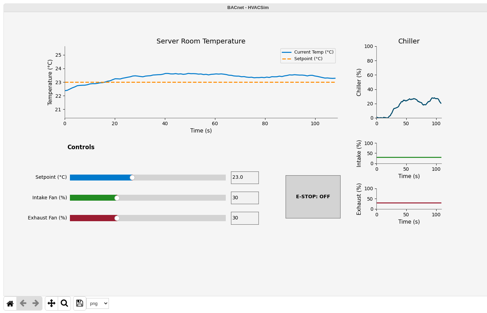

# Scenario 1: Reconnaissance

## Overview

| Field | Value |
|---|---|
| **Tactic** | Discovery, Collection |
| **Techniques** | [T0846 - Remote System Discovery](https://attack.mitre.org/techniques/T0846/), [T0888 - Remote System Information Discovery](https://attack.mitre.org/techniques/T0888/), [T0861 - Point & Tag Identification](https://attack.mitre.org/techniques/T0861/) |
| **Adversary** | HVACSim BACnet Reconnaissance (`docs/adversaries/bacnet-reconnaissance.yml`) |
| **Fact source** | HVACSim Reconnaissance (`docs/sources/hvac-reconnaissance.yml`) |

## Description

The adversary finds HVACSim on the network with a Who-Is broadcast, reads the device's identity and object list, reads the room temperature point, and reads the chiller load. BACnet has no authentication, so the PLC answers every request. Nothing is written, so the process does not change.

## Facts Used

| Fact | Description | Type | Value |
|---|---|---|---|
| `bacnet.device.instance` | PLC device instance | int | `101` |
| `bacnet.object.type` | Object type for Object Collection | string | `analog-input` |
| `bacnet.object.instance` | Object instance for Object Collection | int | `1` (room temperature) |
| `bacnet.obj.type` | Object type for Read Property | string | `analog-input` |
| `bacnet.obj.instance` | Object instance for Read Property | int | `2` (chiller load) |
| `bacnet.obj.property` | Property for Read Property | string | `present-value` |
| `bacnet.read.index` | Array index | int | `-1` (no index, whole property) |

## Steps

Run the adversary with the fact source above, or add these abilities to an operation in this order:

| # | Ability | ID | Facts |
|---|---|---|---|
| 1 | BACnet Who-Is | `b93bd80e-3a70-11eb-adc1-0242ac120002` | discover: none |
| 2 | BACnet Device Collection - Basic | `485e97e7-c352-432d-b8d3-fa8460e4fe49` | identify: `bacnet.device.instance=101` |
| 3 | BACnet Object Collection - Basic | `bd13ac81-b932-463d-95aa-a22aeefbc9ac` | room temperature: `bacnet.device.instance=101`, `bacnet.object.type=analog-input`, `bacnet.object.instance=1` |
| 4 | BACnet Read Property | `47432648-5678-11eb-ae93-0242ac130002` | chiller load: `bacnet.device.instance=101`, `bacnet.obj.type=analog-input`, `bacnet.obj.instance=2`, `bacnet.obj.property=present-value`, `bacnet.read.index=-1` |

Each ability runs once, except as noted below for Who-Is.

## Expected Observations

- Who-Is lists device `101`. In the Docker lab the HMI's own BACnet client answers as well, as device `9101`, and Who-Is adds it to the fact pool. Caldera then runs Device Collection, Object Collection and Read Property once for each discovered device instance, so each also runs against `9101`; those reads return `BACnet Error` because `9101` carries no HVAC objects.
- Device Collection returns object-name `HVACSim`, model-name `HVAC-Sim` and the object list: `(device, 101)`, `(analog-value, 1)`, `(analog-output, 1)`, `(analog-output, 2)`, `(binary-value, 1)`, `(analog-input, 1)`, `(analog-input, 2)`.
- Object Collection returns `current_temperature_c` (analog-input 1): object-name `current_temperature_c`, units `degrees-celsius`, present-value about 22-24 °C at the default setpoint.
- Read Property returns the present value of `chiller_speed_percent` (analog-input 2): a percentage, around 25 % at the default setpoint.
- The PLC logs no `Write:` lines and the HMI does not change.
