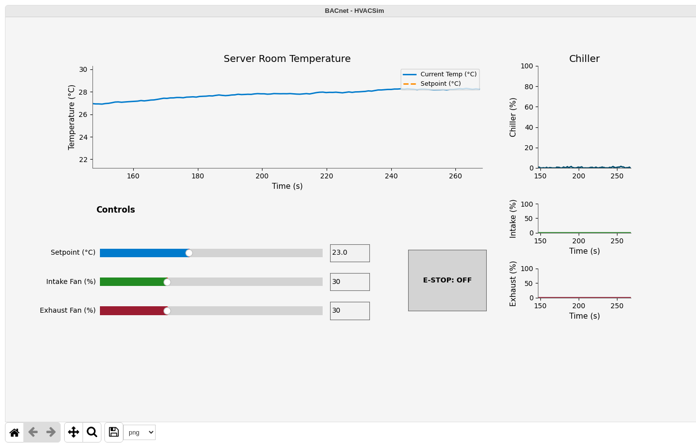

# Scenario 2: Thermal Runaway

## Overview

| Field | Value |
|---|---|
| **Tactic** | Impair Process Control, Impact |
| **Techniques** | [T0855 - Unauthorized Command Message](https://attack.mitre.org/techniques/T0855/), [T0836 - Modify Parameter](https://attack.mitre.org/techniques/T0836/), [T0831 - Manipulation of Control](https://attack.mitre.org/techniques/T0831/), [T0826 - Loss of Availability](https://attack.mitre.org/techniques/T0826/) |
| **Adversary** | HVACSim BACnet Thermal Runaway (`docs/adversaries/bacnet-thermal-runaway.yml`) |
| **Fact source** | HVACSim Facts (`docs/sources/hvac-simulator-facts.yml`) |

## Description

The adversary raises the temperature setpoint above the room temperature, so the chiller's controller stops cooling, then turns both fans off. The PLC accepts the unauthenticated writes at the same priority as the HMI, so they replace the operator's values. With no cooling, the room heats toward the temperature set by ambient heat and server load.

## Facts Used

| Fact | Description | Type | Value |
|---|---|---|---|
| `bacnet.device.instance` | PLC device instance | int | `101` |
| `bacnet.object.type` | Object type for Object Collection | string | `analog-input` |
| `bacnet.object.instance` | Object instance for Object Collection | int | `1` (room temperature), `2` (chiller load) |
| `bacnet.obj.type` | Object type for Read Property and Write Property | string | `analog-value` (setpoint), `analog-output` (fans), `binary-value` (emergency stop), `analog-input` (readings) |
| `bacnet.obj.instance` | Object instance for Read Property and Write Property | int | `1`, `2` |
| `bacnet.obj.property` | Property to read or write | string | `present-value` |
| `bacnet.read.index` | Array index for reads | int | `-1` (no index) |
| `bacnet.write.priority` | Write priority | int | `8` (manual operator, the same as the HMI) |
| `bacnet.write.index` | Array index for writes | int | `-1` (no index) |
| `bacnet.write.tag` | Value type | int | `4` (real), `9` (enumerated) |
| `bacnet.write.value` | Value to write | int | `40` (setpoint), `0` (fan off), `1` (emergency stop active) |

## Control Data

| Control | BACnet Object | Value |
|---|---|---|
| `temperature_setpoint_c` | `analog-value 1 present-value` | `40` |
| `intake_fan_speed_percent` | `analog-output 1 present-value` | `0` |
| `exhaust_fan_speed_percent` | `analog-output 2 present-value` | `0` |

## Steps

Run the adversary with the fact source above, or add these abilities to an operation in this order:

| # | Ability | ID | Facts |
|---|---|---|---|
| 1 | BACnet Object Collection - Basic | `bd13ac81-b932-463d-95aa-a22aeefbc9ac` | baseline: `bacnet.object.type=analog-input`, `bacnet.object.instance=1`, `bacnet.object.instance=2` |
| 2 | BACnet Write Property | `1a2faf5a-4601-11eb-b378-0242ac130002` | writes: `bacnet.obj.type`, `bacnet.obj.instance`, `bacnet.write.tag` and `bacnet.write.value` from the source, which covers the setpoint and both fans |
| 3 | BACnet Read Property | `47432648-5678-11eb-ae93-0242ac130002` | verify: `bacnet.obj.type=analog-input`, `bacnet.obj.instance=1`, `bacnet.read.index=-1` |

## Expected Observations

- Caldera runs Write Property once for every combination of the write facts in the source, so the setpoint, both fans and the emergency stop are each written more than once, with `40`, `0` and `1`. The PLC rejects the combinations that do not fit an object (`BACnet Error` or `BACnet Reject`) and logs each value it changes as `Write: <point> <old> -> <new>`.
- The PLC log holds `Write: setpoint_c`, `Write: intake_pct`, `Write: exhaust_pct` and `Write: estop` lines, and the HMI's fan charts follow them. The last accepted value for a point is the one that stays, so which value ends up in place depends on the order Caldera runs the combinations in.
- Whenever the run ends with the setpoint at `40` or the emergency stop active, cooling is off: the chiller load (analog-input 2) falls to about 0 % within 10 seconds, and the room temperature (analog-input 1) climbs toward about 29 °C, which is what the verify read returns.
- To see the thermal runaway on its own, run Write Property with only the setpoint facts (`bacnet.obj.type=analog-value`, `bacnet.obj.instance=1`, `bacnet.write.tag=4`, `bacnet.write.value=40`). The PLC logs `Write: setpoint_c 23.0 -> 40.0`, the chiller load falls to about 0 % and the room temperature climbs. The HMI scales its temperature chart to the room temperature, so the dashed setpoint line at 40 °C is above the chart, and the setpoint slider keeps its starting value.
