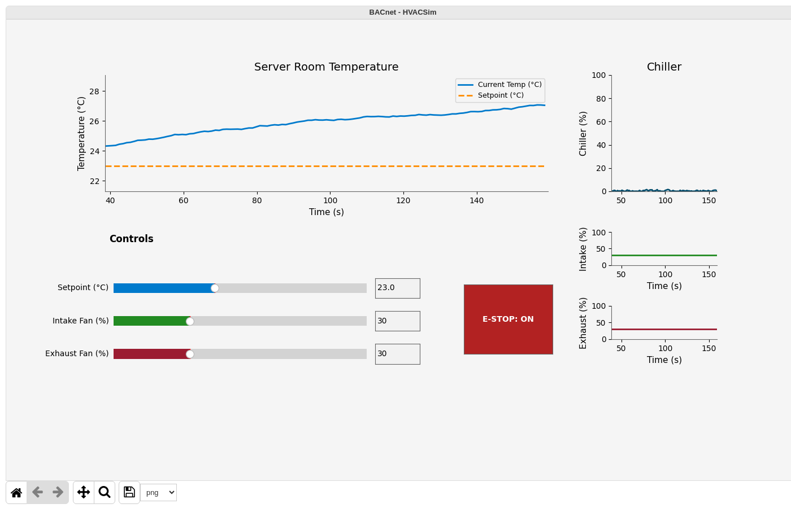

# Scenario 3: Emergency Stop

## Overview

| Field | Value |
|---|---|
| **Tactic** | Impair Process Control, Impact |
| **Techniques** | [T0855 - Unauthorized Command Message](https://attack.mitre.org/techniques/T0855/), [T0826 - Loss of Availability](https://attack.mitre.org/techniques/T0826/) |
| **Adversary** | HVACSim BACnet Emergency Stop (`docs/adversaries/bacnet-emergency-stop.yml`) |
| **Fact source** | HVACSim Facts (`docs/sources/hvac-simulator-facts.yml`) |

## Description

The adversary sets the emergency stop object to active. The PLC accepts the unauthenticated write and forces airflow and the chiller target to 0 %, so a single write removes all cooling from the server room.

## Facts Used

| Fact | Description | Type | Value |
|---|---|---|---|
| `bacnet.device.instance` | PLC device instance | int | `101` |
| `bacnet.object.type` | Object type for Object Collection | string | `analog-input` |
| `bacnet.object.instance` | Object instance for Object Collection | int | `1` (room temperature), `2` (chiller load) |
| `bacnet.obj.type` | Object type for Read Property and Write Property | string | `binary-value` (emergency stop), `analog-value` (setpoint), `analog-output` (fans), `analog-input` (readings) |
| `bacnet.obj.instance` | Object instance for Read Property and Write Property | int | `1`, `2` |
| `bacnet.obj.property` | Property to read or write | string | `present-value` |
| `bacnet.read.index` | Array index for reads | int | `-1` (no index) |
| `bacnet.write.priority` | Write priority | int | `8` (manual operator, the same as the HMI) |
| `bacnet.write.index` | Array index for writes | int | `-1` (no index) |
| `bacnet.write.tag` | Value type | int | `9` (enumerated), `4` (real) |
| `bacnet.write.value` | Value to write | int | `1` (active), `0`, `40` |

## Control Data

| Control | BACnet Object | Value |
|---|---|---|
| `emergency_stop` | `binary-value 1 present-value` | `1` (active) |

## Steps

Run the adversary with the fact source above, or add these abilities to an operation in this order:

| # | Ability | ID | Facts |
|---|---|---|---|
| 1 | BACnet Object Collection - Basic | `bd13ac81-b932-463d-95aa-a22aeefbc9ac` | baseline: `bacnet.object.type=analog-input`, `bacnet.object.instance=1`, `bacnet.object.instance=2` |
| 2 | BACnet Write Property | `1a2faf5a-4601-11eb-b378-0242ac130002` | writes: `bacnet.obj.type`, `bacnet.obj.instance`, `bacnet.write.tag` and `bacnet.write.value` from the source, which covers the emergency stop |
| 3 | BACnet Read Property | `47432648-5678-11eb-ae93-0242ac130002` | verify: `bacnet.obj.type=analog-input`, `bacnet.obj.instance=2`, `bacnet.read.index=-1` |

## Expected Observations

- Caldera runs Write Property once for every combination of the write facts in the source, so the emergency stop, the setpoint and both fans are all written, with `1`, `0` and `40`. The PLC rejects the combinations that do not fit an object (`BACnet Error` or `BACnet Reject`) and logs each value it changes as `Write: <point> <old> -> <new>`.
- The PLC log holds `Write: estop False -> True`. A later combination can write the emergency stop back to inactive, so read the last `Write: estop` line for the state the run left behind.
- While the emergency stop is active the PLC's status line shows `Airflow=0%` and `E-Stop=ON`, the HMI's emergency-stop button is on, and the chiller load (analog-input 2) falls to about 0 % within 10 seconds, which is what the verify read returns.
- With no cooling the room temperature (analog-input 1) climbs on the HMI trend toward about 29 °C.
- To see the emergency stop on its own, run Write Property with only its facts (`bacnet.obj.type=binary-value`, `bacnet.obj.instance=1`, `bacnet.write.tag=9`, `bacnet.write.value=1`).
